# Wazuh SIEM (Rules + Detection)

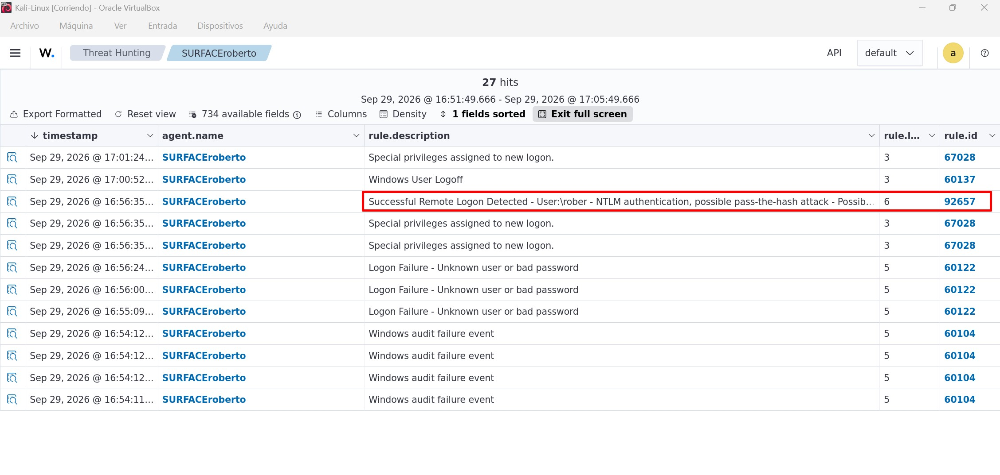

# 1.- Purpose
 
The purpose of this project is to explore the installation, configuration, and security monitoring capabilities of **Wazuh**. The laboratory focuses on learning how to deploy a Wazuh SIEM environment, connect and manage Windows agents, detect vulnerabilities, monitor security events, and investigate potential threats through the Wazuh Dashboard.
 
To achieve this, controlled activities such as failed logons, account modifications, SMB enumeration, and remote authentication are performed to generate security telemetry. The resulting alerts are analyzed to gain practical experience with threat detection, vulnerability management, threat hunting, and basic SOC Tier 1 investigation workflows.

---

## 2.- Environment
This project focuses on deploying and configuring a **Wazuh Security Information and Event Management (SIEM)** environment to monitor, detect, and investigate security-related events generated by Windows endpoints.

The laboratory simulates common security scenarios, including **suspicious network activity, failed authentication attempts, and system events**. Wazuh collects, normalizes, and analyzes logs from connected agents, allowing security analysts to identify indicators of compromise (IOCs), investigate alerts, and understand attacker behavior.

During the project, a Windows endpoint is connected to a Wazuh server running on Kali Linux. Multiple controlled activities are generated to create security telemetry, including including network scans, SMB enumeration, login failures, command execution, and other potentially suspicious actions. The resulting alerts are analyzed through the **Wazuh Dashboard** to understand detection capabilities and incident investigation workflows.


### 2.- Learning Objectives
1. Deploy and configure a Wazuh SIEM environment.
2. Install and manage Windows agents.
3. Collect and analyze Windows security events.
4. Investigate vulnerabilities detected by Wazuh.
5. Generate and analyze suspicious activity from local and remote systems.
6. Perform basic SOC Tier 1 investigations.

---

## 3.- Lab Setup
This section documents the installation and configuration of the Wazuh SIEM lab environment, including the deployment of the Wazuh server on Kali Linux, the Wazuh Agent on Windows 11, and the tools required on Ubuntu to generate controlled suspicious activity for monitoring, detection, and investigation.

### 3.1.- Kali Linux Setup (Wazuh Server)
Install **Wazuh** in your Kali Linux VM.

1. Download the Wazuh installation package.
    1. Make a new empty directory to store the installation file.
    2. Execute `curl -sO https://packages.wazuh.com/4.14/wazuh-install.sh`
        * `curl`: tool to transfer data through HTTP/HTTPS.
        * `-s`: silen. It hides the progress bar.
        * `-O`: saves the file with its original name.
        * `wazuh-install.sh`: official name for the instalation script.

The Wazuh installation guide uses `curl` to download the official installation script from the Wazuh repository. The downloaded script automates the deployment of the Wazuh Manager, Indexer, Dashboard, and supporting components.
 
Although `wget` could have been used to download the same file, `curl` is the method recommended in the official documentation and is commonly used in Linux administration, automation, and web-based deployments.

#### Why Is the Installation File a Script?
 
The Wazuh installation file is a **Bash script** that automates the deployment process. Instead of manually installing and configuring each component, the script performs all required tasks, including repository configuration, dependency installation, certificate generation, service configuration, and deployment of the:
- Wazuh Manager, 
- Indexer, 
- Dashboard, and 
- Filebeat components.
 
Using a script simplifies the installation process, reduces configuration errors, and ensures that all components are installed in the correct order.

2. Give execution permisions to file:
    * `chmod +x wazuh-install.sh` 
3. Execute the installer with administrative privileges:
    * `sudo ./wazuh-install.sh -a`
        * `-a`: instructs the installer to deploy all major Wazuh components on the same system (same machine, normally, Wazuh can be deployed across multiple servers).
    * This process may take a couple of hours.

4. Verify the **three main Wazuh** components run correctly:
    1. Wazuh Indexer: `sudo systemctl status wazuh-indexer --no-pager`
    2. Wazuh Manager: `sudo systemctl status wazuh-manager --no-pager`.
    4. Wazuh Dashboard: `sudo systemctl status wazuh-dashboard --no-pager`
        * If Wazuh Manager service **fails** to start after a installation and returns a timeout error, restart the service manually with: `sudo systemctl restart wazuh-manager`.

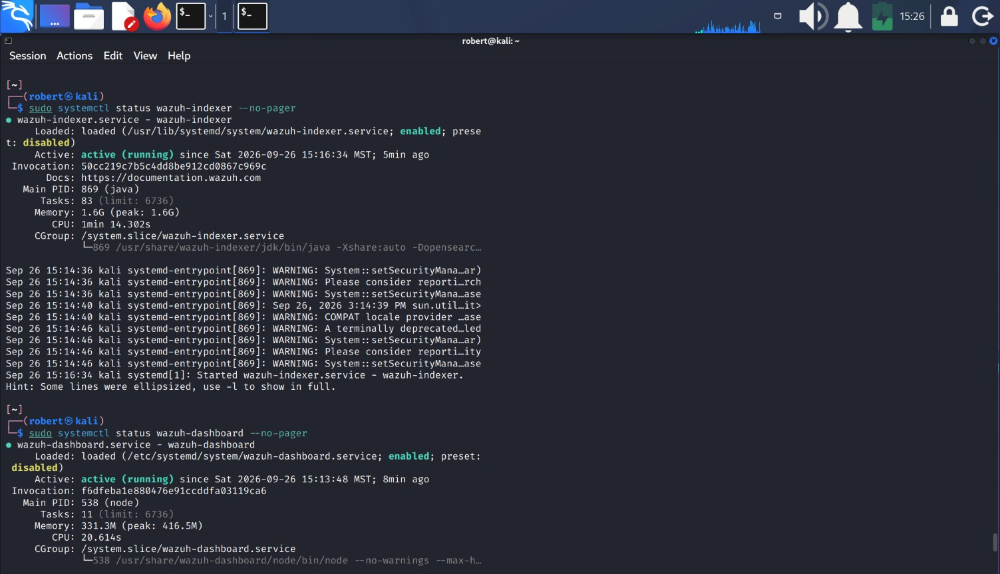

```
1. Wazuh Indexer: The Wazuh Indexer stores, indexes, and organizes security data collected from monitored endpoints. It enables fast searching and retrieval o events for analysis and investigation.

2. Wazuh Manager: is the central component responsible for processing events, analyzing logs, applying detection rules, and generating security alerts. It receives information from connected agents and coordinates the platform's security monitoring activities.

3. Wazuh Dashboard: is a web-based interface used to visualize alerts, monitor endpoints, and investigate security events. It provides analysts with a centralized platform for searching, reviewing, and managing security data.
```


5. Acces Wazu Dashboard (GUI).
    1. Check for the server IP.
    2. Open a web browser such as **Firefox** and navigate to `https://SERVER_IP`.
    3. A security warning will appear, click on accept and advance.
    4. You will land to the Wazuh loggin site, where a **username** and a **password** will be required.
    5. You can find those credentials following this method:
        1. Search for the **wazuh-install-files.tar** file with:
            * `find ~ -name "wazu*.tar"`.
        2. Go to that directory and get a list of the **wazuh-install-files.tar** contents:
            * `sudo tar -tf wazuh-install-files.tar`
        3. You will find the **wazuh-passwords.txt** file.
        4. Make a new directory to extract the **waxuh-passwords.txt** file in it.
        5. Extract the file with:
            * `sudo tar -xf wazuh-install-files.tar -C wazuh-creds wazuh-install-files/wazuh-passwords.txt`.
        6. Use `cat` to explore the contents and search for this line ***Admin user for the web user interface and Wazuh indexer. Use this user to log in to Wazuh dashboard***.
        7. Use the `indexer_username` and the `indexer_password` on the **Wazuh logging page**.
        8. You will automatically enter the **dashboard**.

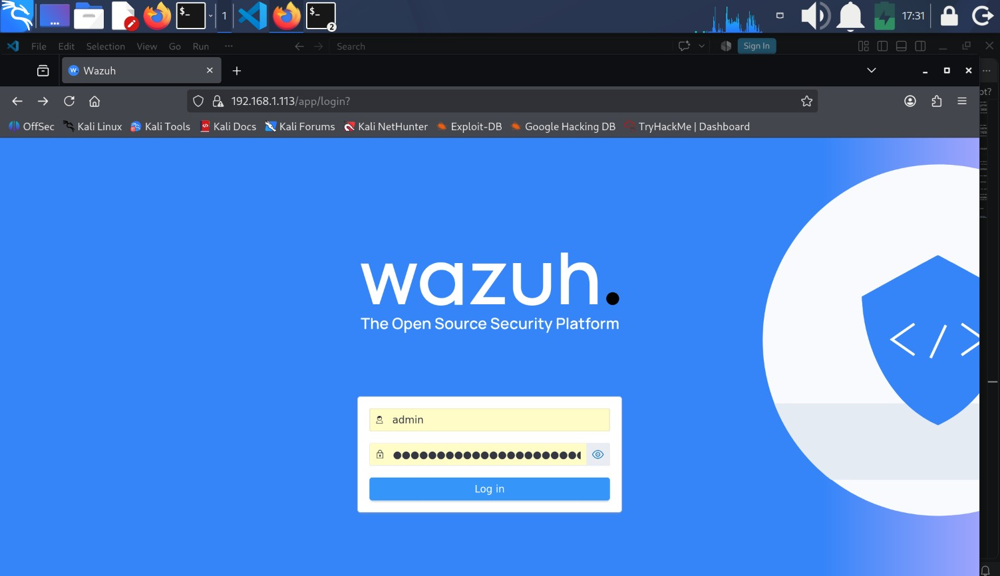

6. **API connection offline**: If the Wazuh Dashboard loads successfully but displays a message indicating that the API connection is offline or inaccessible, verify that the Wazuh API service is running and reachable.
    1. Verify Wazuh Manager Status:
        * `sudo systemctl status wazuh-manager --no-pager`.
        * If the service is not running, restart it:
            * `sudo systemctl restart wazuh-manager`.
    2. Verify the API Listening Port: check wheter the Wazuh API is listening on port **55000**.
        * `sudo ss -tulpn | grep 5000`.
        * A successful result should show a process listening on port **55000**.
    3. Test the API locally: verify that the API is responding locally:
        * `curl -k https://127.0.0.1:55000`.
        * A response indicating that authentication is required confirms that the API is online and responding to requests.
    4. Verify Dashboard Connectivity: after confirming that the API is operational, restart the dashboard service if necessary:
        * `sudo systemctl restart wazuh-dashboard`.
        * Then refresh the Wazuh Dashboard and verify that the API connection status changes from **Offline** to **Online**.
    5. After receiving a response indicating that authentication is required (`curl -k https://127.0.0.1:55000`) is 100% that the APIs connection are established.
    6. To confirm this Navigate to the dashboard---> Dashboard Management ---> Server APIs.
    7. The dashboard displays the following status:
        * Status: Online
        * Host: https://127.0.0.1
        * Port: 55000
        * Version: v4.14.8

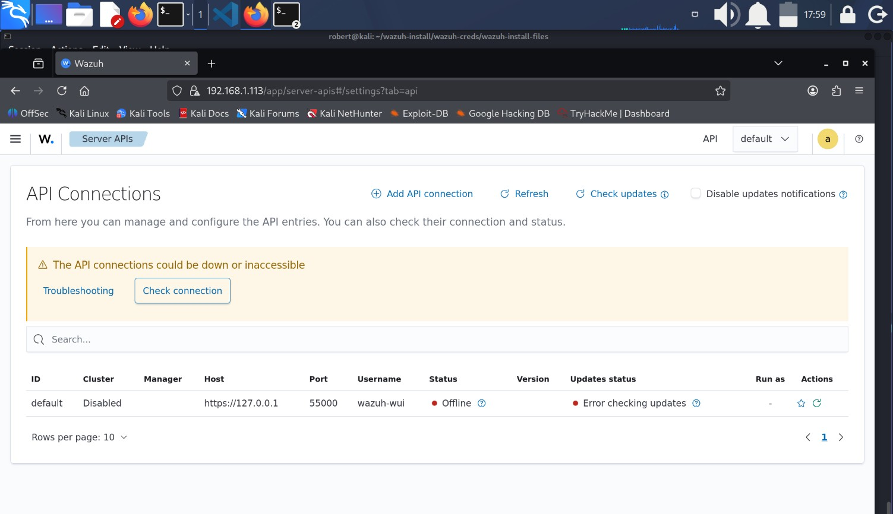
#### Dashboard showing offline API

---


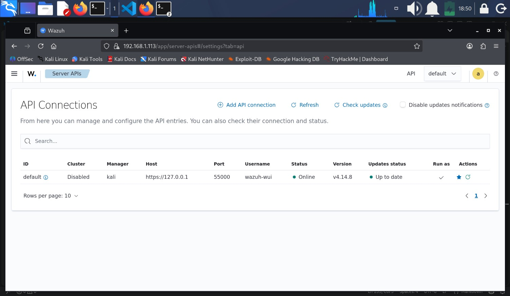
#### Dashboard showing online API

**Initiate Wazuh manually**: By default, Wazuh initiates automatically everytime you turn on your system or reboot. For this laboratory this is not necessary due to the large amaunt of resourses Wazuh uses.    
1. To deactivate Wazuh automatic start execute:
    * `sudo systemctl disable wazuh-manager`.
    * `sudo systemctl disable wazuh-indexer`.
    * `sudo systemctl disable wazuh-dashboard`
2. Now, to activate Wazuh when needed execute:
    1. `sudo systemctl start wazuh-indexer`.
    2. `sudo systemctl start wazuh-manager`.
    3. `sudo systemctl start wazuh-dashboard`.
        * Wait 30-60 seconds between each service to activate. To confirm status is best practice before activating the next one.
3. To stop them:
    1. `sudo systemctl stop wazuh-dashboard`.
    2. `sudo systemctl stop wazuh-manager`.
    3. `sudo systemctl stop wazuh-indexer`.

---

### 3.2.- Windows 11 Setup (Wazuh Agent/Client)

1. Get the server (Kali) IP.
2. In Kali, navigate to **Agents Summary** ---> Summary ---> Deploy new agent.
3. Select the package to download and install on your system, in this case **Windows**.
4. Enter the server IP address.
5. Enter an agent name. This is optional, by default the deployment uses the hostname as the agent name.
6. Select a group. For this lab the group `default` is selected.
7. Copy the provided command `Invoke-WebRequest -Uri` ... and execute it in Windows.
8. In the same shell terminal execute `NET START Wazuh` to start the service.
9. Wazuh agent is now installed in `C:\Program Files (x86)\ossec-agent`.
10. Wazuh agent will start automatically everytime you reboot or turn on your computer, the following commands are useful to configure this startup:
	1. Verify start mode and status: `Get-CimInstance Win32_Service -Filter "Name='WazuhSvc'" | Select Name, StartMode, State`.
	2. To change the start mode to **manual** execute: `Set-Service -Name WazuhSvc -StartupType Manual`.
	3. To stop the service execute: `Stop-Service WazuhSvc`.
	4. To **start** the service execute: `Start-Service WazuhSvc`.
	5. To set the service to automatically start execute: `Set-Service -Name WazuhSvc -StartupType Automatic`.

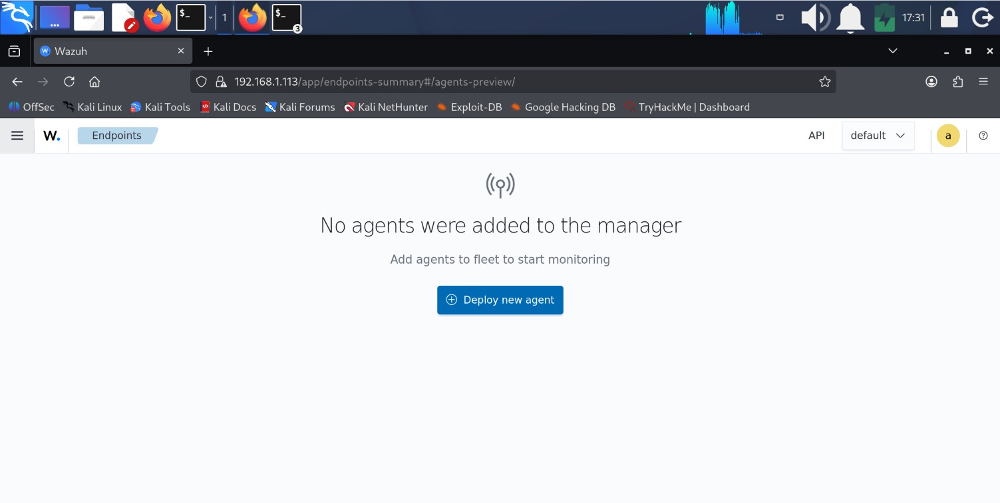
#### Deploy new agent


## 4.- Overview the client in the server dashboard.
1. Go to the server dashboard, navigate to Agents Managemet ---> Summary, now you will see the client connected to the server.
2. You will see the following information about the client: id, name, IP address, group, Operating System, cluster node, version, status (active), and **actions**.
3. In the actions column you will find two icons:
	1. View Agent Details (Eye-like icon): this is to see more details about the client arranged in sections:
		* System Inventory: This shows hardware information like the number of cores, memory, CPU name, and Host Name and serial number.
		* Events Count Evolution:
		* MITRE ATT&CK: 
		* Compliance: 
		* Vulnerability Detection: here is a vulnerability detection ranking which includes 4 levels: low, medium, high and critical. This levels include a counter. This section also includes a Top 5 packages subsection.
		* Security Configuration Assesment: 
	2. All actions (three squares icon): click this icon to display the following options:
		* View agent details:
		* Agent Configuration:
		* Edit groups:
		* Upgrade:
		* Remove: 

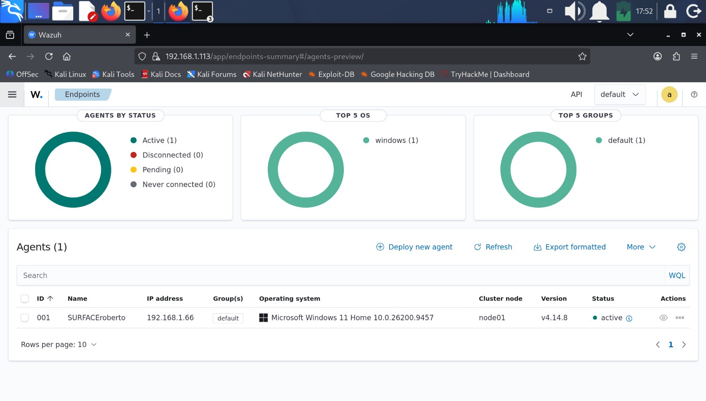
#### Agent status active

### 4.1.- Investigate client Security Events and Vulnerabilities.
Wazuh enables security analysts to investigate both security events and vulnerabilities. Security events represent activities that may indicate normal behavior, suspicious activity, or potential attacks, while vulnerabilities are weaknesses in operating systems or applications that could be exploited by threat actors.

#### 4.1.1.- Investigate Security Events.
1. Navigate to the **Wazuh** dashboard ---> Agents Management ---> Summary ---> Actions ---> View Agent Details ---> **Threat Hunting**.
	1. The Threat Hunting dashboard provides an overview of events, alerts, and security activity collected from monitored endpoints. For example it will display a counter for:
		* Level 12 or above alerts.
		* Authentication Failure.
		* Authentication Success. 
```
Wazuh Severity Scale
"Level 12 or Above Alerts" displays high-priority security alerts with a Wazuh severity score of 12 or higher.
Wazuh uses a severity scale ranging from 0 to 15, where levels 0-3 are informational, 4-6 indicate low to moderate security relevance, 7-9 represent suspicious activity requiring attention, 10-11 correspond to important security alerts, and 12-15 identify critical events. 
Alerts in the 12-15 range typically represent potentially malicious activity, policy violations, privilege abuse, indicators of compromise, or other security events that require immediate analyst attention and investigation."
```
* 
	2. Click on the `Events` tab.
	3. A list of Events will be displayed with the following information: timestamp, agent.name, rule.description, rule.level and rule.id.
	4. `rule.level`: Rule Level represents the severity assigned by Wazuh to a detected event based on the rule that was triggered. It helps analysts prioritize alerts and determine which events require immediate attention.
    5. The following table represents the severity rule levels:	
| Rule Level | Meaning |
|------------|---------|
| **0–3** | Informational events with little or no security impact. |
| **4–6** | Low to moderate relevance events that may require review. |
| **7–9** | Suspicious activity that deserves analyst attention. |
| **10–11** | High-priority security alerts. |
| **12-15** | Critical alerts that often require immediate investigation and possible escalation. |

* 
	5. You can **sort** the rule.level column or you can add a **filter** to display the events with a particular severity.
	6. Select an event of your interest, for example the level 8 `rule.description`: **User account changed**. Click on the `Inspect document details` to the left of the `agent.name`.
    7. The following is the most important information about this event:

| Field | Value | Brief Explanation |
|---------|---------|---------|
| Event ID | **4738** | Windows detected that a user account was modified. |
| Rule ID | **60110** | Wazuh rule triggered by an account modification event. |
| Rule Description | **User account changed** | Indicates that attributes of an existing user account were modified. |
| Rule Level | **8** | Suspicious activity that deserves analyst attention according to the Wazuh severity scale. |
| Affected User | **rober** | User account associated with the modification event. |
| Display Name | **Roberto Orozco** | Display name associated with the affected account. |
| Host | **SURFACEroberto** | Endpoint where the event was generated. |
| MITRE Technique | **T1098 - Account Manipulation** | Technique involving modification of existing accounts. |
| MITRE Tactic | **Persistence** | Attackers may modify accounts to maintain access to a system. |
| Result | **AUDIT_SUCCESS** | Windows successfully recorded the account modification event. |
| Timestamp | **Sep 28, 2026 @ 13:15:47** | Time the event was detected by Wazuh. |

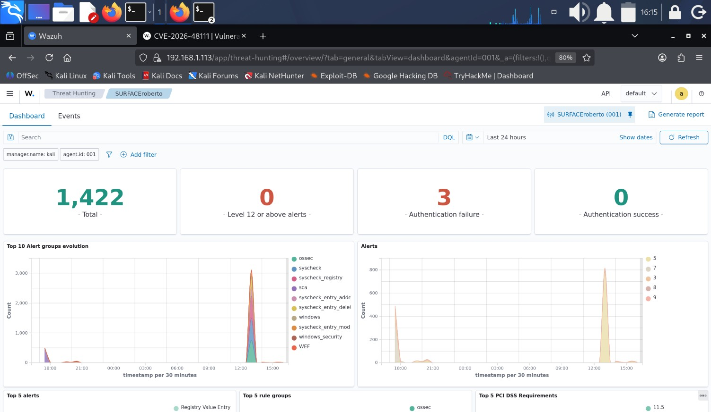
#### Threat Hunting dashboard

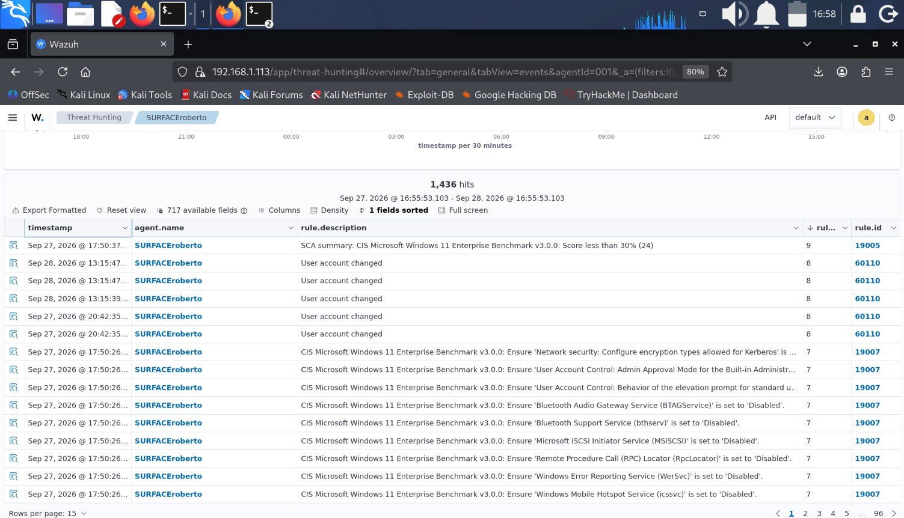
#### Events

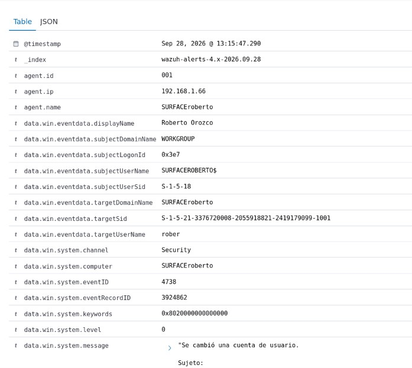
#### Event details

2. You can also access Threat Hunting through the **Overview** page.

##### 4.1.1.1.- Recommended Analyst Actions
1. Review the alert: confirm the event details.
2. Identify the affected account: verify which user account was modified (rober).
3. Validate the change: determine whether the modification was expected, authorized, or part of normal administrative activity.
4. Check surrounding events: Review related authentication, account management, or privilege-related events occurring around the same time.
5. Assess the risk: evaluate whether the change could indicate account manipulation or presistence activity.
6. Document findings: record the affected host, user, timestamp, and investigation outcome.
7. Escalate if necessary: escalate to Tier 2 or Incident Response only if the account modification appears unauthorized, suspicious, or linked to additional malicious activity.


---


#### 4.1.2.- Investigate vulnerabilities.
1. Navigate to the  **Wazuh** dashboard ---->  Agents Management ---> Summary ---> Actions ---> View Agent Details ---> **Vulnerability Detection** Section.
	1. Select the level of severity you want to investigate, in this case we are going to investigate the **High-Severity** level, click on `High - Severity`.
	2. Wazuh will get you to the Vulnerability Detection dashboard, again click on `High-Severity` level.
	3. You will notice a new filter `High` is added.
	4. On top of the dashboard you will see thre tabs: Dashboard (which is where you are), Inventory, and Events. Go to the `Inventory` tab.
	5. A list of **vulnerabilities**  will be displayed. Notice that the number of ***hits*** matches the number of the counter previously seen in the dashboard.
	6. Also notice that the filter `High` remains in this section.
	7. Select the vulnerability you want to investigate further by clicking on the `Inspect Vulnerability Details` icon (the one on the left of each row).
	8. For instance, investigate the vulnerability with the id `CVE-2026-48111` related to the package `7-Zip 25.01 (x64)`. Delailed information about the vulnerability will appear in a new window. The most important fields to notice are:
		* Package: 7-Zip 25.01 (x64)
		* CVE: CVE-2026-48111
		* Severity: High
		* CVSS Score: 7.1
		* Detection Source: National Vulnerability Database.
		* Vulnerability Description: 7-Zip is a file archiver with a high compression ratio. Versions 9.21 through 26.00 contain an off-by-one out-of-bounds read vulnerability in the ParseDepedencyExpression function of the UEFI firmware image parser(CPP/7zip/Archive/UefiHandler.cpp). The function validates an attacker-controlled opcode byte using > instead of >= against the element count of the 10-entry kExpressionCommands static array, allowing an opcode value of 10 to read one pointer slot (8 bytes on x64) past the end of the array in .rodata. The out-of-bounds value is then dereferenced as a const char * and passed through strlen and memcpy into the archive's Characts property, which may cause either a denial of service (access violation when the adjacent bytes do not form a valid readable pointer) or a minor information disclosure of an adjacent .rdata string literal into archive metadata. The vulnerability is reached automatically during IInArchive::Open() via the call path OpenFv/OpenCapsule → ParseVolume → ParseSections when processing a SECTION_DXE_DEPEX (0x13) or SECTION_PEI_DEPEX (0x1B) section whose first body byte is 0x0A, and the UEFI handler is enabled by default in stock 7z.dll with signature-based detection for both UEFIc and UEFIf formats. The outcome (crash vs. silent leak) is deterministic per build but linker-layout dependent, with no write primitive and no disclosure of heap data, secrets, or ASLR base addresses. Version 26.01 fixes the issue.

        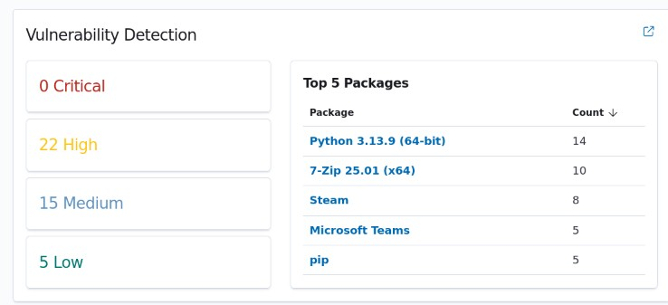
        #### Vulnerability detection section

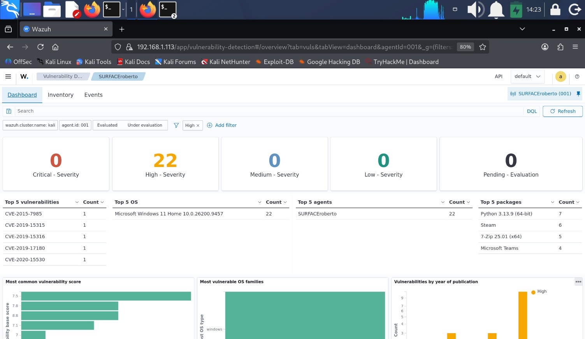
#### Vulnerability dashboard

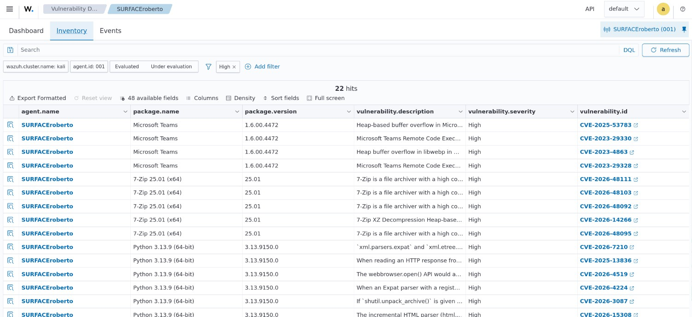
#### Vulnerability inventory

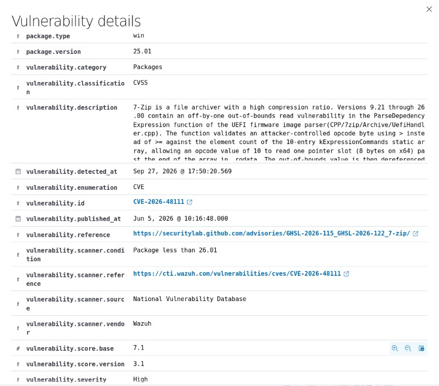


2. You can also access Vulnerability Detection through the **Overview** page.

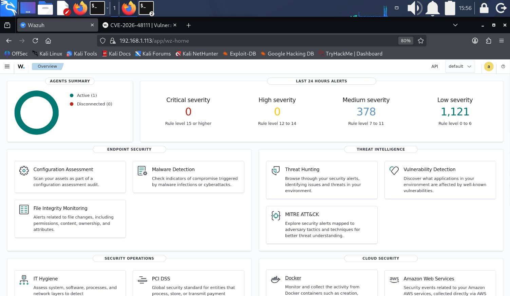


##### 4.1.2.1.- Recommended Analyst Actions.
Once a vulnerability is found, the security analyst profesional must take the proper actions to mitigate or erradicate the vulnerability. For a SOC tier 1 analyst the actions would be:
1. Validate the finding:
	1. Confirm the vulnerability exists.
	2. Verify the affected artifact.
	3. Confirm the vulnerable version (7-Zip 25.01)

2. Evaluate risk:
	1. Check severity (High).
	2. Check the CVSS (7.1).
	3. Understand the impact (Denial of Service and Information Disclosure).

3. Document the finding.
4. Create a ticket: send the finding to the Vulnerability Management team, IT, or Systems Administration.
5. Recommend remediation: Update 7-Zip to the 26.01 version.
	1. Verify the update was applied.
	2. Confirm the vulnerability desapears in Wazuh.


##### 4.1.2.2.- Consequences of not addressing this vulnerability.
For this specific vulnerability, the consequences of nos addressing it are:
1. Denial of Service (DoS): 
	1. 7-Zip could suddenly close or block.
	2. The user could temporarily lose access to the application.
2. Limited Information Disclosure:
	1. Part of the adyacent information in memory could be exposed.
	2. The impact is limited.
3. Increase of attack surface: to keep a vulnerable software eases further attacks that take advantage of known vulnerabilities.


---

## 5.- Security activity simulation.
To demonstrate how **Wazuh** works, suspicious activity will be performed in the client's computer (agent - client) and in a third VM using Ubuntu. In this scenario all three computers must be connected:
1. Kali as the server must be connected to Windows as the agent to be monitored.
2. Ubuntu does not have to be connected to Kali.
3. A user in Windows will perform suspicius activities in that same computer.
3. A user in Ubuntu will perform a series of suspicious actions targeted to the Windows client.
4. Kali will detect those actions through Wazuh dashboard.


---

### 5.1.- Security event generation activities:

1. This is the activity list to generate events in Wazuh:

| # | Origin | Activity | Command / Action | Expected Evidence in Windows | Probability of Being Detected by Wazuh |
|---|--------|----------|------------------|------------------------------|----------------------------------------|
| 1 | Windows | Failed Logon Attempts | Lock workstation (`Windows + L`) and enter an incorrect password 4-5 times | **Event ID 4625** (Failed Logon) | **95-100%** |
| 2 | Windows | Create Local User | `net user TestUser123 Password123! /add` | Account creation events | **90-100%** |
| 3 | Windows | Delete Local User | `net user TestUser123 /delete` | Account deletion events | **90-100%** |
| 4 | Windows | Add User to Administrators Group | `net user TestAdmin Password123! /add`<br>`net localgroup Administrators TestAdmin /add` | Privileged group membership modification events | **95-100%** |
| 5 | Windows | Remove User from Administrators Group | `net localgroup Administrators TestAdmin /delete` | Privileged group membership modification events | **95-100%** |
| 6 | Ubuntu | Failed SMB Authentication | `smbclient -L //192.168.1.66 -U FakeUser` | **Event ID 4625** (Failed Logon) | **80-95%** |
| 7 | Ubuntu | Multiple Failed SMB Authentications | Execute the previous command multiple times using invalid credentials | Multiple **Event ID 4625** entries | **85-95%** |
| 8 | Ubuntu | Successful SMB Authentication | `smbclient -L //192.168.1.66 -U <valid_user>` | **Event ID 4624** (Successful Logon) | **80-95%** |
| 9 | Ubuntu | SMB Share Enumeration | `smbclient -L //192.168.1.66` | SMB access and authentication-related events | **80-90%** |
| 10 | Ubuntu | Authenticated SMB Session | `smbclient //192.168.1.66/IPC$ -U rober` | **Event ID 4624** (Successful Logon), User: `rober`, Workstation: `UBUNTU-DESKTOP`, Authentication: `NTLMv2`, Logon Type: `3 (Network Logon)` | **90-100%** |


2. Events detected in Wazuh:

| # | Activity | Generated On | Wazuh Event | Rule ID | Severity |
|---|----------|--------------|-------------|---------|----------|
| 1 | Failed Logon Attempts | Windows Endpoint (SURFACEroberto) | Logon Failure - Unknown user or bad password | 60122 | 5 |
| 2 | Create Local User | Windows Endpoint (SURFACEroberto) | User account enabled or created | 60109 | 8 |
| 3 | Create Local User | Windows Endpoint (SURFACEroberto) | User account changed | 60110 | 8 |
| 4 | Delete Local User | Windows Endpoint (SURFACEroberto) | User account disabled or deleted | 60111 | 8 |
| 5 | Add User to Administrators Group | Windows Endpoint (SURFACEroberto) | Administrators Group Changed | 60154 | 12 |
| 6 | Add User to Administrators Group | Windows Endpoint (SURFACEroberto) | Users Group Changed | 60170 | 5 |
| 7 | Add User to Administrators Group | Windows Endpoint (SURFACEroberto) | Domain Users Group Changed | 60160 | 5 |
| 8 | Add User to Administrators Group | Windows Endpoint (SURFACEroberto) | Special privileges assigned to new logon | 67028 | 3 |
| 9 | SMB Share Enumeration | Ubuntu (192.168.1.100) → Windows Endpoint (SURFACEroberto) | Successful Remote Logon Detected - User:\ANONYMOUS LOGON - NTLM authentication, possible pass-the-hash attack | 92652 | 6 |
| 10 | SMB Authentication | Ubuntu (192.168.1.100) → Windows Endpoint (SURFACEroberto) | Successful Remote Logon Detected - User:\rober - NTLM authentication, possible pass-the-hash attack - Possible RDP connection | 92657 | 6 |

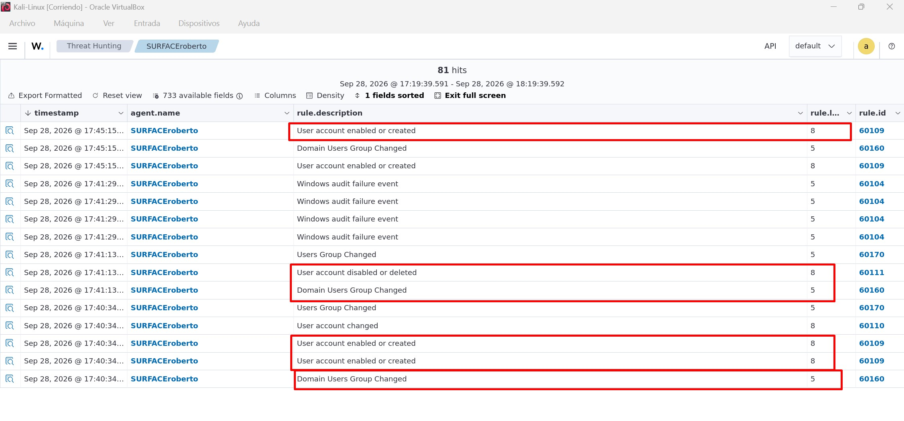
#### Simulated activity sample 1

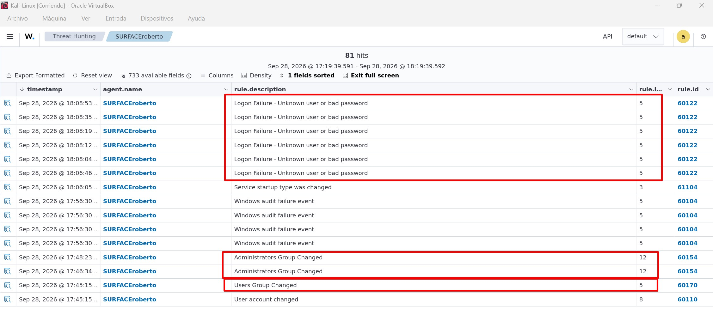
#### Simulated activity sample 2
### 5.2.- Security event investigation
After generating security events from both the Windows endpoint and the Ubuntu host, the next step is to investigate one of the most significant alerts detected by Wazuh: **Successful Remote Logon Detected - User:\rober - NTLM authentication, possible pass-the-hash attack - Possible RDP connection**.

**This is the most important information about the event:**
| Field | Value | Description |
|---------|---------|---------|
| Event ID | **4624** | Successful logon recorded by Windows Security Auditing. |
| Rule ID | **92657** | Wazuh rule triggered by successful remote authentication activity. |
| Rule Level | **6** | Medium-priority event that should be reviewed by a security analyst. |
| Source IP | **192.168.1.100** | Ubuntu host that initiated the connection. |
| Workstation Name | **UBUNTU-DESKTOP** | Name of the remote system that established the session. |
| Target Host | **SURFACEroberto** | Windows endpoint that received the connection. |
| Target User | **rober** | Successfully authenticated user account. |
| Logon Type | **3 (Network Logon)** | Remote network-based logon. |
| Authentication Package | **NTLM** | Authentication protocol used. |
| NTLM Version | **NTLM V2** | More secure than NTLMv1. |
| Result | **AUDIT_SUCCESS** | Authentication completed successfully. |


#### Successful Remote Logon Detected

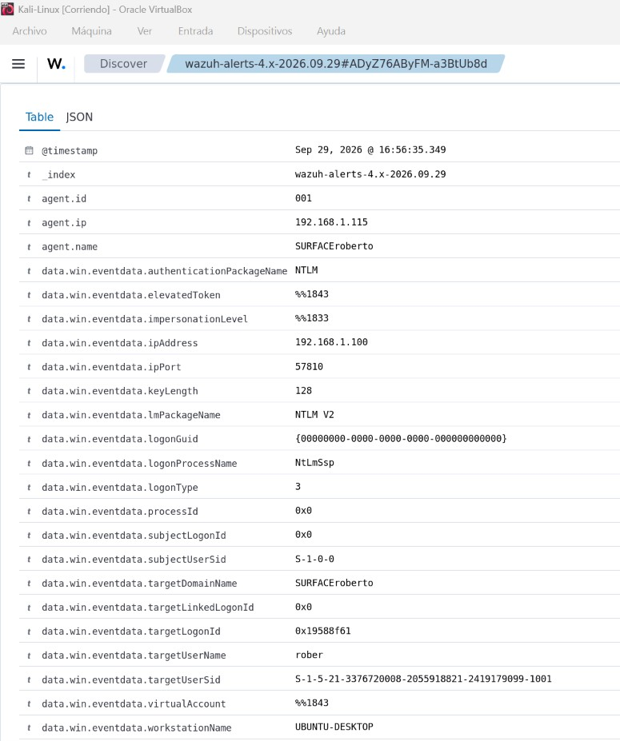
#### Event details

### Analysis
**A successful remote network logon was detected from 192.168.1.100 (UBUNTU-DESKTOP)** to the Windows endpoint SURFACEroberto. Windows recorded the activity as a successful logon for the user account rober using NTLMv2 authentication. Wazuh generated Rule **92657** with a severity level of **6**, indicating remote authentication activity that should be reviewed by a security analyst. The event was generated after executing the command `smbclient //192.168.1.66/IPC$ -U rober` from the Ubuntu host, which successfully authenticated to the Windows SMB service and established a valid network session.

### Recommended SOC Tier 1 Response
 
1. Validate the Source
    - Verify whether the source IP address (**192.168.1.100**) belongs to a trusted asset.
    - Confirm that **UBUNTU-DESKTOP** is a known and authorized system.
 
2. Verify the User Account
    - Confirm that the account **rober** is authorized to perform remote SMB authentication.
    - Review recent account activity for unusual behavior.
 
3. Review Authentication Details
    - Confirm that the authentication method (**NTLMv2**) is expected within the environment.
    - Determine whether the logon occurred during an authorized maintenance, administrative task, or security test.
 
4. Investigate Related Events
    - Search for additional events involving:
    - User `rober`
    - Source IP `192.168.1.100`
    - SMB authentication activity
    - Failed logon attempts preceding the successful authentication
 
5. Assess the Scope of Access
    - Determine whether the session only established network connectivity or whether it accessed file shares, administrative resources, or sensitive data.
 
6. Document the Findings
- Record:
    - Source host
    - Destination host
    - User account
    - Authentication method
    - Timestamp
    - Investigation results
 
7. Escalate if Necessary
 
- Escalate to Tier 2 or Incident Response if:
    - The source system is unknown.
    - The account owner cannot explain the activity.
    - Multiple suspicious authentication events are observed.
    - Evidence of file access, lateral movement, or privilege abuse is found.


---

End of project **one**.
- Roberto Orozco