## Security Onion (Zeek + Suricata)
### 1.- Purpose
The purpose of this project was to deploy and validate a Security Onion environment capable of providing network visibility, telemetry collection, and security monitoring capabilities through Zeek, Suricata, Fleet, Hunt, and Detections.

The project also aimed to gain practical experience with:

1. Security Onion deployment and administration.
2. Elastic Fleet endpoint enrollment.
3. Zeek network telemetry.
4. Security event investigation through Hunt.
5. Alert analysis through Detections.
6. Network Security Monitoring (NSM) concepts.
7. Sensor placement and network visibility considerations.

Although full network visibility was not achieved due to **architectural limitations** of the virtualized deployment, the project successfully demonstrated the deployment and operation of a Security Onion monitoring platform and provided valuable insight into the relationship between network architecture and monitoring effectiveness.

#### 1.2.- What is Security Onion?
Security Onion is a Linux-based security monitoring platform that combines multiple open-source tools into a unified solution for network visibility, intrusion detection, log management, event correlation, and threat investigation.

Rather than being a single security tool, Security Onion provides a dedicated operating environment that integrates technologies such as Zeek for network telemetry, Suricata for intrusion detection, OpenSearch for event storage and indexing, Security Onion Dashboards for visualization and analysis, and Alert Management services for event triage and investigation, all within a centralized monitoring platform.

#### 1.2.1.- Suricata
Suricata is an open-source Intrusion Detection System (IDS) that monitors network traffic in real time and generates alerts when suspicious or malicious activity matches predefined detection rules.

#### 1.2.2.- Zeek
Zeek is an open-source Network Security Monitoring (NSM) platform that captures and logs detailed information about network activity, providing visibility and context for investigations.

### 2.- Learned Skills
This project provided hands-on experience with:

1. Deploying Security Onion in a virtualized environment.
2. Configuring Security Onion using **Evaluation Mode**.
3. Understanding Security Onion architecture and components.
4. Working with OpenSearch and Security Onion **Dashboards**.
5. Enrolling endpoints through **Elastic Fleet**.
6. Deploying and validating **Elastic Agent**.
7. Troubleshooting **Fleet Server** communication issues.
8. Creating custom firewall rules with iptables.
9. Using **Hunt** to investigate telemetry from multiple data sources.
10. Understanding event modules and datasets.
12. Distinguishing between **telemetry** and **detections**.
13. Exploring Zeek-generated network telemetry.
14. Understanding **Suricata's** role within Security Onion.
15. Troubleshooting service health and synchronization issues.
16. Investigating endpoint monitoring limitations.
17. **Understanding network visibility and sensor placement concepts.**
18. Evaluating the impact of virtualization on Network Security Monitoring deployments.


### 3.- Project Environment
This project was implemented using a virtualized Security Onion deployment hosted on a Microsoft Surface Laptop 4 running Windows 11.

The original design included three components:

1. Windows 11 host acting as the monitored endpoint.
2. Security Onion virtual machine acting as the monitoring platform.
3. Kali Linux virtual machine intended to generate attack traffic.

During implementation, Security Onion and Kali Linux could not be operated simultaneously for extended periods due to **hardware resource constraints**. Running both virtual machines alongside the Windows host resulted in memory utilization approaching 97%, significantly affecting performance.

As a result, the project **evolved** into a deployment, monitoring, and architecture validation exercise focused on:

1. Security Onion deployment.
2. Endpoint enrollment through Fleet.
3. Hunt investigations.
4. Detections analysis.
5. Zeek telemetry exploration.
6. Network visibility analysis.

Within Security Onion:

1. **Zeek** provided network telemetry.
2. **Suricata** provided IDS functionality.
3. **OpenSearch** stored security events.
4. **Fleet** managed endpoint enrollment and communications.
5. **Hunt** and **Detections** provided investigation and analysis workflows.


### 4.- Download and Install Security Onion
1. Navigate to `https://github.com/Security-Onion-Solutions/securityonion/blob/3/main/DOWNLOAD_AND_VERIFY_ISO.md` and download the file `securityonion-3.3.0-20260911.iso`.
2. Create a dedicated Virtual Machine usin the **ISO** file.
3. Name that machine `Security Onion`.
4. Make sure the machine has thie minimum requirements: 110 GB of SSD, 8 GB of memory, and 6 procesors.
5. Do not make an attended installation.
6. Open Virtual Box: Select the `Security Onion` VM ---> Settings ---> Network ---> Enable 2 network adapters:
	1. Make sure the first adapter is a bridge type adapter.
	2. The second one should be a Host Only type adapter.
7. Start the `Security Onion` machine.
8. The Security Onion GRUB will initiate, select `Install Security Onion 3.3.0`.
9. Create an administrator user name and password.
10. The installation will start the first phase which is managed by anaconda. Let the system run automatically.
11. After 15 minutes or so, anaconda will finish its job and Whiptail will take on.
12. On whiptail, you will set a series of important options in order for the installation completes successfully:
	1. Deployment Type: Eval (Evaluation Mode). Avoid production type if you are not monitoring a large network or if your resources are limited, the installation will fail.
	2. Management Interface: select the Security Onion machine interface.
	3. Assign an IPv4 address to this installation: type the IP addres in CIDR notation of the Security Onion machine.
	4. Default Gateway: type the IP address of you Security Onion machine gateway.
	5. DNS Server: type the Router IP and a public DNS server.
	6. Allowed IP or Subnet: the IP from which the Security Onion Dashboard will be accessed (in this case the Windows machine IP).
	7. Enter an email to access the Security Onion dashboard through the web.
	8. Enter a password for that email.
	9. A summary of your settings will be displayed and you will be asked if everything is alright, if so select `OK`. 
	10. The installation will start, this process can take around 5 hours.
13. In some installations, Whiptail may display an installation warning indicating that one or more componentes encountered errors.
14. Select `OK`. You will be directed to the prompt.
15. Execute `sudo so-status` and verify that core services such as Elasticsearch, Kibana, Fleet, Zeek, and Suricata are reported as running.
16. On the host machine open a webbrowser and navigate to the IP of your Security Onion (is the IP address you selected for the Security Onion installation.)
17. Enter the email and password you provided during the installation.
19. If you can successfully access the Security Onion Dashboard and log in using the email address and password configured during installation, the Security Onion deployment can be considered successful.


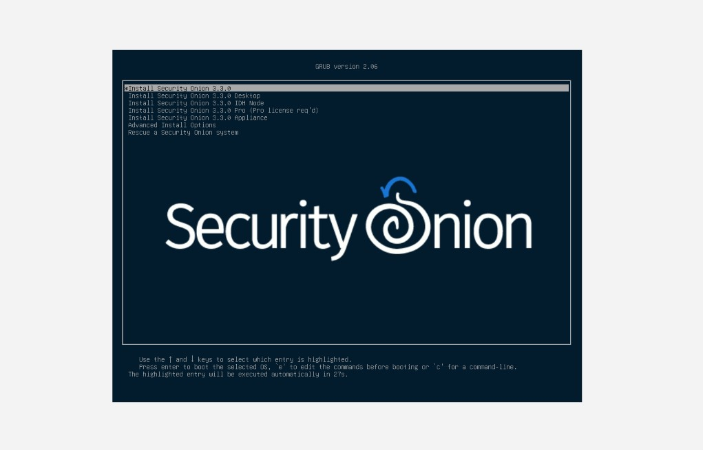
#### Select a Security Onion version

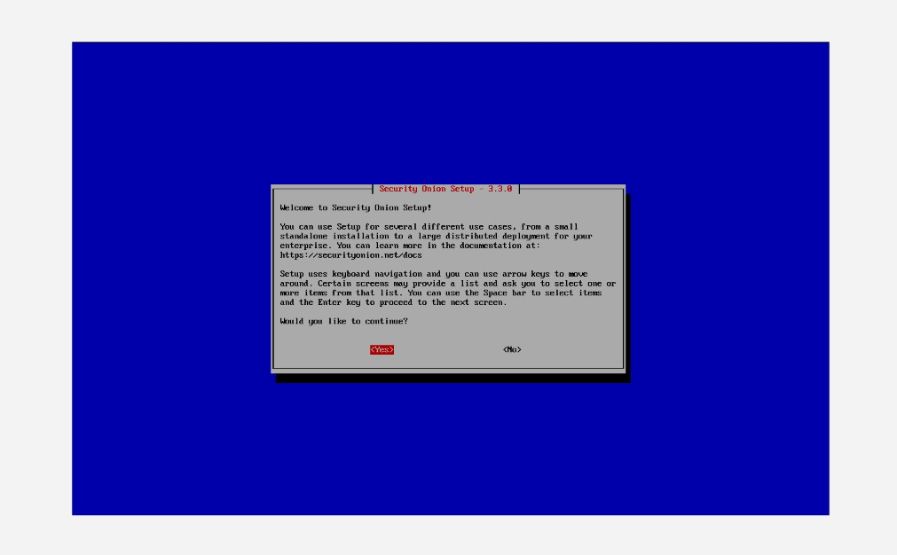
#### Configure SO deployment

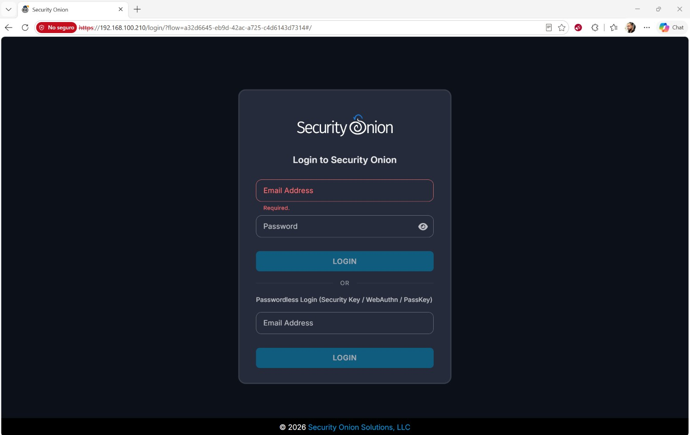
#### Enter your credentials to access the dashboard.

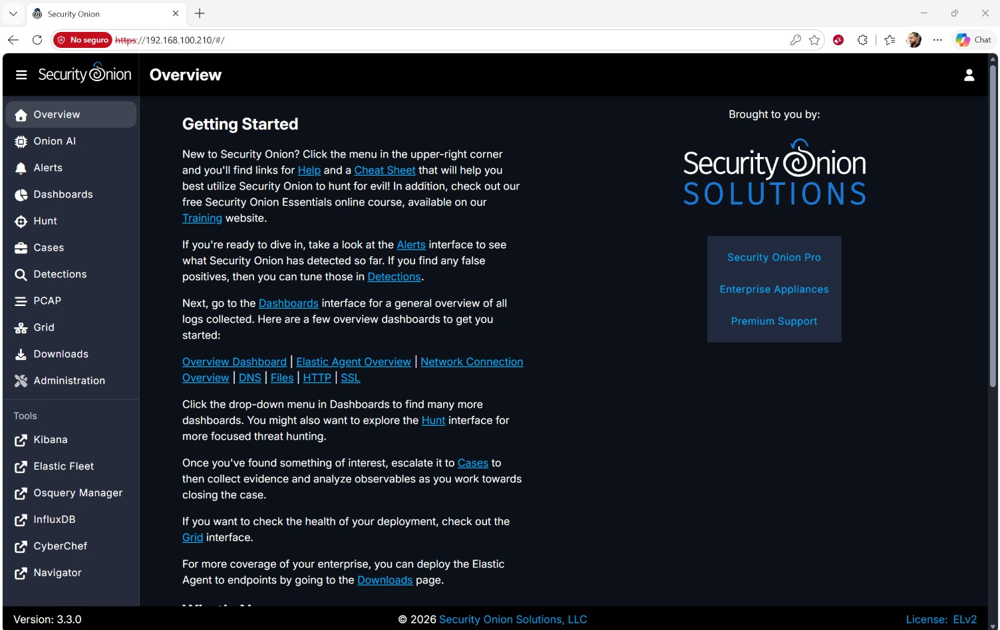

---

### 5.- Post-Installation Validation
1. Verify that the Security Onion **node status** is reported as **OK** in **Grid**. This confirms that the node has successfully initialized and that core services are communicating properly.
	* If the node status is reported as **Fault**, wait a few minutes and refresh the page.
	* If the issue persists, verify the status of the core services by executing: `sudo so-status`. **The node should only be considered healthy when Grid reports `OK` and the core services are running.**
2. Verify that **Suricata** status is reportes as `OK` in the **Detections** section. If the status shows `Snc Filed`, wait a few minutes and refres the page. Security Onion may still be completing background synchronization tasks after installation.

```
NOTICE:
Immediately after installation, Grid may report a 'Fault' status and Suricata may report 'Sync Failed'. This can occur while Security Onion is still completing background initialization tasks. Allow the platform additional time to stabilize and refresh the Dashboard before performing troubleshootin. In this deployment, both statuses eventually changed to 'OK' without manual intervention.
```

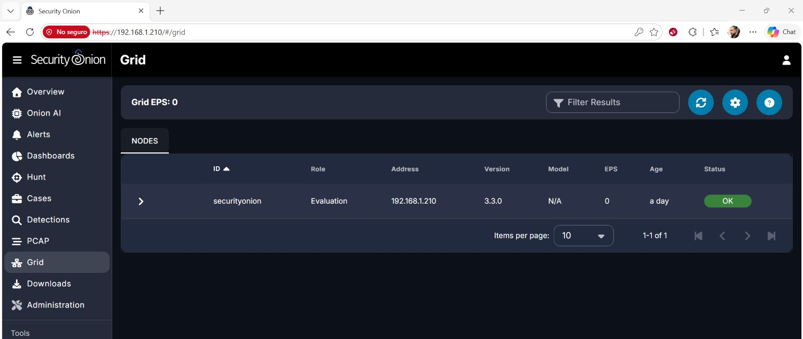
#### Grid reports OK

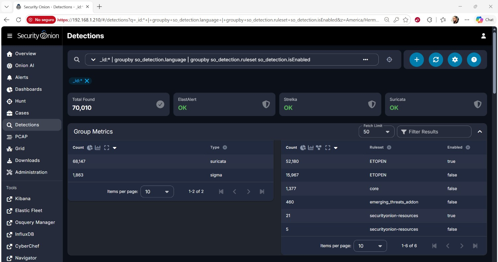
#### Suricata reports OK

### 6.- Connecting Windows to Security Onion
1. Click on `Elastic Fleet`, which is a tool on the Security Onion dashboard menu at the left of the screen.
2. A new tab will apper on your browser, Elastic will ask for your credentials (which are the same you use to enter the Security Onion dashboard).
3. You will land on the main page, where you can see the enrolled agents and some general information abouth them.
4. Go to `Settings` ---> `Agent Binary Download` and set `Elastic Artifacts` with Host `https://artifacts.elastic.co/downloads/` as the default.
5. Go back to `Agents` ---> `Add` ---> `Agent`.
6. Select the folowing options
	1. What type of host do you want to monitor?: `endpoints-initial`.
	2. Enroll in Fleet?: Select `Enroll in Fleet (recommended)`.
	3. Install Elastic Agent on your host: select the plattform of your agent, in this case `Windows x86_64`.
	4. Fleet will display a PowerShell command.
7. Before executing the command on PowerShell, create an **ip tables rule** on your Security Onion server to allow the endpoint to communicate with **Fleet Server** on port `8220`.
	* In this case the rule is `sudo iptables -I DOCKER-USER 1 -s <WINDOWS_ENDPOINT_IP>/32 -p tcp --dport 8220 -j ACCEPT`.
	* The port 8220 is the port used by Elastic Fleet to establish communication between the Elastic Agent and the Fleet Server.
8. Execute the command on the agent machine (Windows ---> `PowerShell` as administrator), and make sure to append the `--insecure` flag to the command. This option allows Elastic Agent to trust the self-signed Fleet Server certificate and complete the enrollment process.
	* The `--insecure` flag was required because Fleet Server was using a self-signed TLS certificate. Without this option, Elastic Agent could not verify the certificate and the enrollment process failed.
10. PowerShell will display a message confirming that the Elastic Agent was successfully enrolled and installed.
11. Wait a few minutes for the newly enrolled agent to appear in Fleet.
12. Once this process is complete, Security Onion will begin monitoring the WIndows endpoint through Elastic Agent.

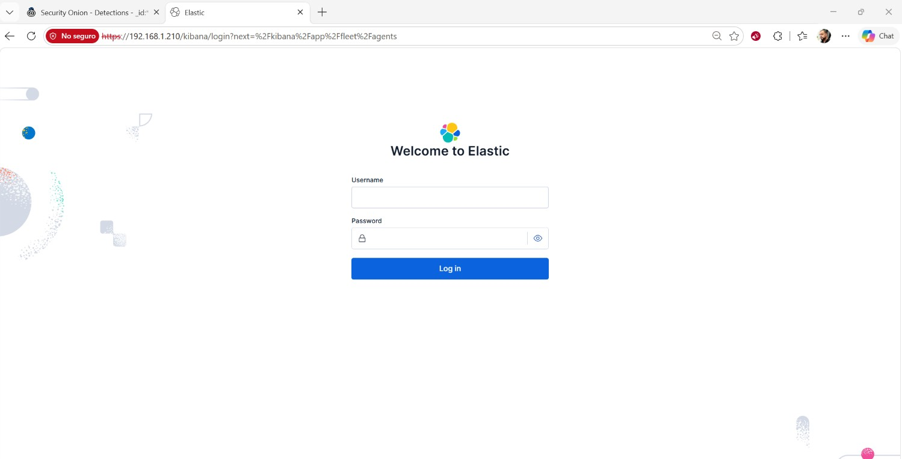
#### Elastic Fleet login page

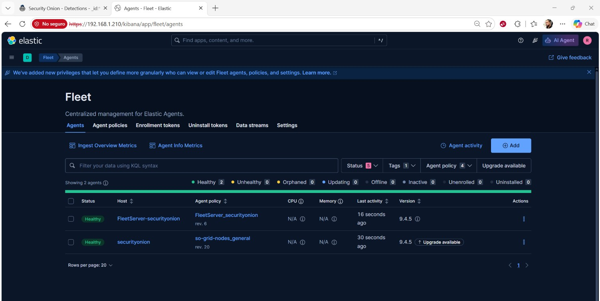
#### Elastic Fleet overview

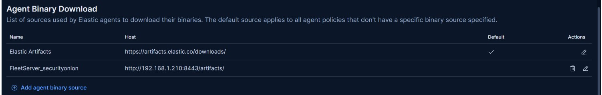
#### Agent binary download

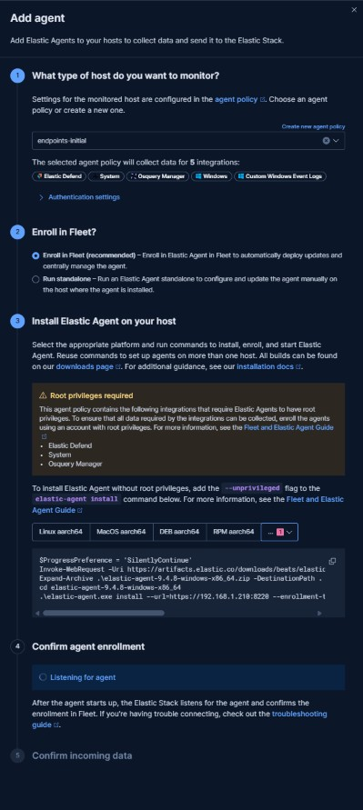
#### Add an agent

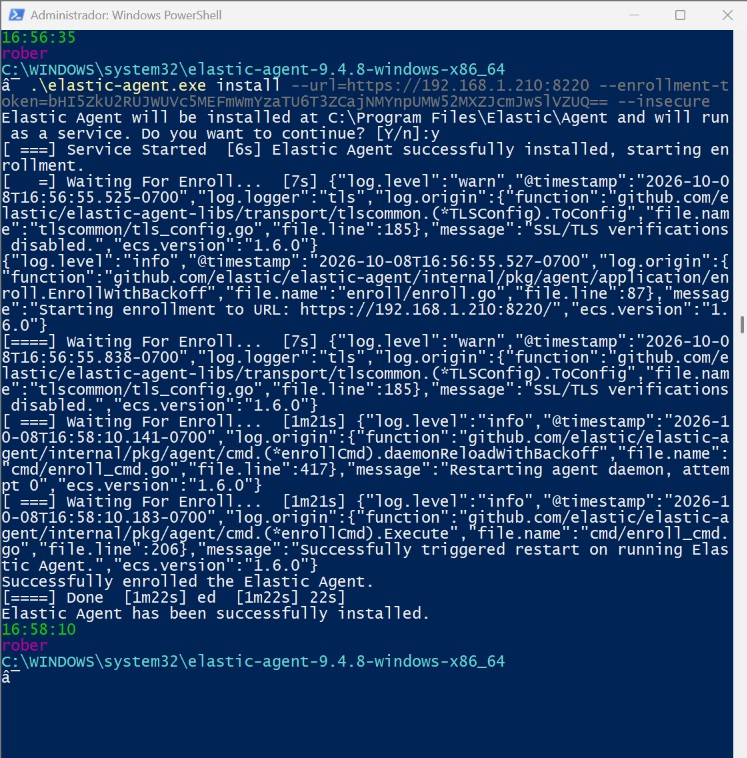
#### Add the agent in PowerShell

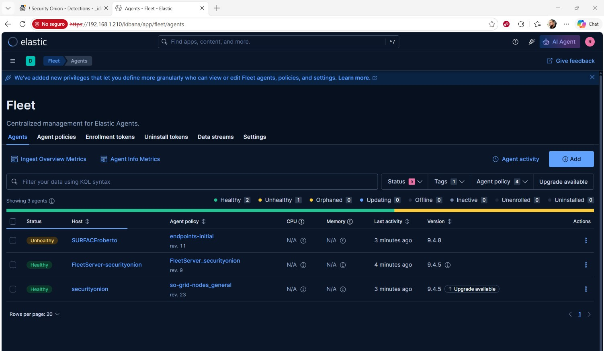
#### Agent added

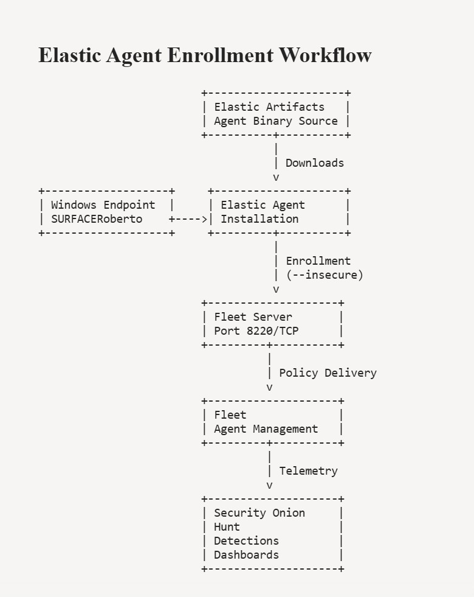
#### Enrollment workflow

#### 6.1.- Important definitions
1. **Elastic Agent**: is the software installed on an endpoint that collects system and security telemetry and sends it to Fleet Server for centralized monitoring and management.
2. **Fleet**: the Elastic component responsible for enrolling agents and applying policies to monitored endpoints.
3. **Fleet Server**: is the service that manages communication between Elastic Agents and Fleet, handling agent enrollment, policy delivery, and status reporting.
4. **Elastic Artifacts**: is the official Elastic repository that hosts Elastic Agent installation packages and related binaries.
5. **Agent Binary Download**: defines the source from which Elastic Agents download their installation packages and updates.
6. **Elastic Fleet**: is the centralized management platform used to deploy, configure, monitor, and update Elastic Agents across multiple endpoints.


### 7.- Hunt
**Hunt** displays all telemetry collected by Security Onion, including network, system, and endpoint events. These events may represent normal activity, administrative activity, or potentially suspicious behavior. Hunt acts as a centralized repository of information where analysts can investigate what happened on a network or endpoint, regardless of whether the activity is considered malicious.

The information displayed in Hunt can originate from several Security Onion components, including Zeek, Suricata, Elastic Agent, operating system logs, and other integrated data sources. Because Hunt contains both benign and suspicious activity, it is commonly used for investigations, threat hunting, incident response, and network analysis.

When Hunt is opened for the first time, it executes the following default query:

* `| groupby event.module* event.dataset`
This query retrieves all available events within the selected time range and groups them according to their `event.module` and `event.dataset` values. The purpose of this query is to provide a **high-level overview of the telemetry currently collected by Security Onion**.

The Hunt interface can be divided into three sections:

1. **Search and Summary Section**, this section contains:

	1. Search Box Allows searches based on agent IDs, hostnames, modules, datasets, tools (such as Zeek or Suricata), IP addresses, and many other fields. Learning how to build searches is one of the most important skills for investigating specific hosts, users, or network activity.

	2. Time Filter Defines the time range covered by the search.

	3. Total Found Displays the total number of events matching the current query.

	4. Excluded Data Sources Shows which data categories are excluded from the search.

	4. Most Occurrences Chart Displays which telemetry sources (Zeek, System, Kratos, Elasticsearch, etc.) are generating the highest number of events.

	5. Timeline Chart Provides a visual overview of event activity over time.

2. **Group Metrics Section**
This section groups events according to their `event.module` and `event.dataset` values and displays the total number of events for each group.

This information is valuable because it helps analysts quickly identify:

- Which telemetry sources are active.
- Which datasets generate the largest volume of events.
- Which sources may be relevant during an investigation.

Examples of common datasets include:

- zeek.dns
- zeek.conn
- system.syslog
- elastic_agent


3. **Events Section**
This section displays individual events returned by the search query.

Each event is initially shown with summary information such as:

- Timestamp
- event.dataset
- Message

Each event can be expanded to reveal additional details and fields related to the activity being investigated.

It is important to note that the default Hunt query provides a global view of the environment and **not necessarily a detailed view of a specific endpoint**. To investigate activity related to a particular host, agent, user, or network service, the search query must be refined accordingly.

For example, the following searches can be used:

- event.dataset:zeek.dns
Displays DNS activity monitored by Zeek.

- event.dataset:zeek.conn
Displays network connection activity monitored by Zeek.

- agent.id:"<AGENT_ID>"
Displays events associated with a specific Elastic Agent.

- event.module:suricata
Displays events generated by Suricata.

By refining searches, Hunt becomes a powerful tool for network investigation, threat hunting, and security monitoring.


[hunt](14_hunt.jpg)
#### Hunt overview


### 8.- Detections
**Detections** displays events that matched one or more security **detection rules**. Detection alerts can be generated from data collected by tools such as Zeek, Suricata, Elastic Agent, or other Security Onion components. Unlike Hunt, which displays all collected telemetry, **Detections focuses only on events that have been identified as potentially relevant from a security perspective.**

For example, a DNS query observed by Zeek may appear in Hunt as a normal event. However, if that DNS activity matches a detection rule associated with malicious behavior, Security Onion may generate an **alert** that becomes visible in Detections. In this way, Hunt provides visibility into all collected activity, while Detections highlights activity that warrants additional investigation.

When Detections is opened for the first time, it executes the following default query:

* `_id:* | groupby so_detection.language | groupby so_detection.ruleset so_detection.isEnabled`
This query retrieves all available detections and groups them according to their detection source and ruleset.

The Detections interface can be divided into three sections:

1. **Search and Summary Section**, this section contains:

	1. Search Box Allows searches based on detection fields, rulesets, severity levels, detection types, timestamps, and other detection-related information.

	2. Total Found Displays the total number of detections matching the current query.

	3. ElastAlert Status Displays the current status of the ElastAlert detection engine.

	4. Strelka Status Displays the synchronization status of the Strelka malware analysis component.

	5. Suricata Status Displays the status of Suricata detection rules and related alert generation.

2. **Group Metrics Section**, this section summarizes detections by source and ruleset.

	1. The first table groups detections according to their detection language or source. Typical values include:

		- suricata
		- sigma

These values indicate the technology responsible for generating the detection.
* 
	2. The second table groups detections by ruleset and indicates whether the rules are currently enabled or disabled.

Examples of rulesets include:

- ETOPEN
- core
- emerging_threats_addon
- securityonion-resources

* This information helps analysts understand:

	1. Which detection sources are generating alerts.
	2. Which rulesets are producing the highest number of detections.
	3. Which rule collections are enabled or disabled.

3. **Detections List**
This section displays individual detections.

Each detection represents an event that matched one or more security detection rules.

The following information is displayed for each detection:

- Enabled
- Overrides
- Severity
- Type
- Ruleset
- Timestamp
- Title

Each detection can be expanded to reveal additional details about the alert and the activity that triggered it.

It is important to understand that detections are generated from previously collected telemetry. While Hunt displays all collected events regardless of whether they are benign or suspicious, Detections displays only events that matched one or more security detection rules.

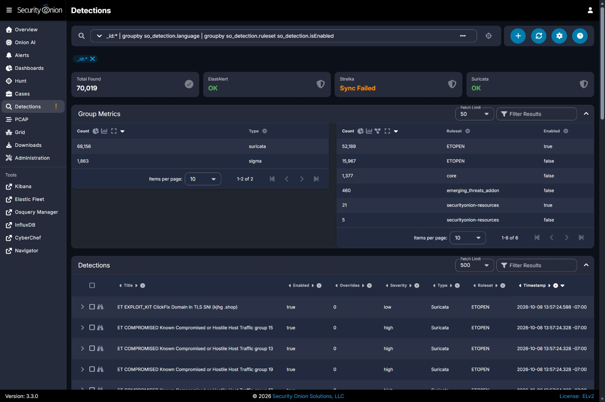
#### Detections overview

### 9.- Findings and lessons learned

This project produced several important **technical findings** related to Security Onion deployment, endpoint monitoring, and **Network Security Monitoring (NSM) architecture**.

#### 9.1.- Endpoint Enrollment and Fleet Communication

The Windows 11 host was successfully enrolled into Elastic Fleet using Elastic Agent.

During testing, Fleet Server communication initially failed because Security Onion blocked incoming connections to TCP port `8220`, which is required for communication between Elastic Agent and Fleet Server.

The issue was resolved by creating the following firewall rule on the Security Onion server:

`sudo iptables -I DOCKER-USER 1 -s <WINDOWS_ENDPOINT_IP>/32 -p tcp --dport 8220 -j ACCEPT`

Once the rule was applied, the endpoint successfully appeared in Fleet and communication with Fleet Server was established.

An important operational finding was that this rule is not persistent and must be recreated after restarting the Security Onion virtual machine.

---

#### 9.2.- Resource Constraints

The project was implemented on a Microsoft Surface Laptop 4 with 16 GB of RAM.

Security Onion operated successfully within an 8 GB virtual machine and all major services reported a running status through:

`sudo so-status`

However, running both Security Onion and Kali Linux virtual machines simultaneously caused memory utilization to approach 97%, **significantly reducing system responsiveness** and limiting the ability to perform extended attack simulation exercises.

As a result, the project **evolved from an attack simulation lab into a deployment, telemetry exploration, and architecture validation exercise**.

---

#### 9.3.- Hunt Telemetry Exploration

Hunt successfully provided visibility into telemetry collected from multiple Security Onion components.

Examples of observed datasets included:

- zeek.dns
- zeek.conn
- system.syslog
- elastic_agent


These datasets demonstrated that Security Onion was successfully collecting and indexing telemetry from the platform itself, Elastic Agent, and Zeek.

The project also provided practical experience building Hunt queries using:

- event.dataset
- event.module
- agent.id
- source.ip
- destination.ip


which are essential skills for security investigations and threat hunting activities.

---

#### 9.4.- Network Visibility Findings

One of the most important findings of the project was related to network visibility.

The Security Onion virtual machine was configured with:

- Adapter 1: Bridged
- Adapter 2: Host-Only


Initial testing suggested that simply deploying Security Onion as a bridged virtual machine **does not automatically provide visibility into all network communications occurring within the local network**.

Although Zeek generated telemetry and Elastic Agent communication was successfully established, **testing did not provide conclusive evidence that Security Onion could observe all traffic generated between devices communicating on the local network**.


**Network visibility depends not only on the monitoring software itself but also on network architecture, sensor placement, routing design, and traffic flow.**

---

#### 9.5.- Security Onion Service Validation

Core Security Onion services were successfully deployed and validated.

Examples of validated services included:

- OpenSearch
- Fleet Server
- Zeek
- Suricata
- Dashboard Services

During testing, Dashboard synchronization indicators occasionally reported statuses such as: `Sync Failed`.


even while the underlying services were reported as running.

This demonstrated the importance of verifying service health using multiple sources of information rather than relying exclusively on Dashboard status indicators.

---

#### 9.6.- Lessons Learned

This project provided practical experience in several areas of Security Operations and Network Security Monitoring:

- Security Onion deployment and administration.
- Elastic Fleet endpoint enrollment.
- Elastic Agent troubleshooting.
- Security Onion Hunt investigations.
- Understanding Zeek datasets and network telemetry.
- Understanding the relationship between telemetry and detections.
- Virtualized security monitoring architectures.
- Service validation and troubleshooting techniques.
- Network visibility analysis.
- Sensor placement considerations.

The most significant lesson learned was that successful deployment of monitoring tools does not automatically guarantee visibility into network traffic. Effective monitoring requires both properly functioning tools and an **architecture** that allows sensors to observe the traffic of interest.

### 10.- Conclusion


This project successfully demonstrated the deployment of Security Onion in a virtualized environment and the enrollment of a Windows endpoint through Elastic Fleet.

Through **Hunt** and **Detections**, I gained practical experience exploring security telemetry, investigating events, and understanding how Security Onion components work together.

One of the most important lessons learned during this project was that successful deployment of monitoring tools does not automatically guarantee network visibility. Effective monitoring depends on both properly functioning tools and the ability of the sensor to observe the traffic being monitored.

Overall, this project provided valuable hands-on experience with Security Onion, Fleet, Zeek, Suricata, Hunt, and Network Security Monitoring concepts.


---
End of project **two**
- Roberto Orozco